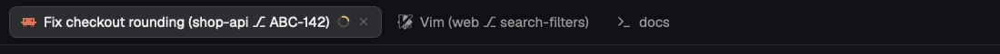

# herdr-tab-autoname

A [Herdr](https://herdr.dev) desktop app mod that names your tabs after the work in them, as `task (folder ⎇ branch)`.



Tabs you name yourself are left alone. The mod only reads Herdr's live data and renames tabs. It starts no programs, makes no network requests and reads no files.

## Install

A mod only runs while a layout hosts it, and Herdr's shipped layouts are read-only, so this takes a personal copy of your layout.

1. Copy `mods/tab-autoname/` to `~/.config/herdr-app/mods/`.
2. Duplicate your layout. This also switches to the copy:

   ```sh
   herdr-app do layout.clone '{"name":"main","as":"my-layout"}'
   ```

3. Add this to the root node of `~/.config/herdr-app/layouts/my-layout.json`. The block renders nothing, so you won't see it:

   ```json
   "floating": [
     { "id": "tab-autoname", "content": { "mod": "tab-autoname" }, "edge": "bottom", "align": "end" }
   ]
   ```

4. Run `herdr-app check ~/.config/herdr-app/mods/tab-autoname`.

Your copy won't pick up future Herdr changes to `main`. Renaming only runs in layouts that host the mod.

## See the whole name

Herdr's tab bar cuts names off at 170px, which usually leaves only the task showing. To widen it:

1. Run `herdr-app do mod.clone '{"name":"tabs","as":"my-tabs"}'`.
2. In `mods/my-tabs/main.js`, change `max_w(170)` to something like `max_w(480)`.
3. Point the `tabs` block in your layout at `my-tabs`.

## Names

| Tab has | Name |
|---|---|
| An agent reporting a task | `Fix checkout rounding (shop-api ⎇ ABC-142)` |
| A running program | `Vim (web ⎇ search-filters)` |
| A plain shell | `web ⎇ search-filters` |
| A main branch | `docs` (`main`, `master`, `develop` and `trunk` are left out) |

Long branches shorten to their ticket number if they have one. To hand a tab you named back to the mod, clear its name:

```sh
herdr-app do tab.rename --id <tab> --name ""
```

## Limits

- Names update on a 2 second check, so they can lag slightly.
- In a split tab, the first agent names the tab, otherwise the first running program, otherwise the first shell.
- ssh sessions show as the ssh program, without the machine name.

## Tests

```sh
cd mods/tab-autoname && node names.test.mjs
```

## Credit

The naming rules are adapted from [herdr-automatic-rename](https://github.com/qu8n/herdr-automatic-rename) by Quan Nguyen, the plugin for the Herdr terminal app. MIT licensed.
