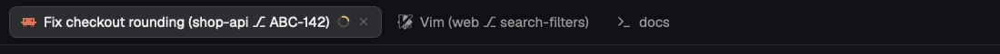

# Tab Autoname

Tabs name themselves after the work in them, as `task (folder ⎇ branch)`, so several agent tabs can be told apart at a glance. There is nothing new to look at: only the tab names change.

## What you see

- No visible panel. The mod's floating block renders an empty `div()`, which has 0×0 bounds.
- Tab names, in whichever tab bar the layout uses:
  - Agent or program with a folder and branch: `Fix checkout rounding (shop-api ⎇ ABC-142)`
  - No branch to show: `Fix checkout rounding (shop-api)`
  - Plain shell: `shop-api ⎇ ABC-142`, or `shop-api` on a trunk branch
- `⎇` is U+2387, separated from the branch by one space.
- Limits: task or program 32 characters, folder 16, long branch 16. Text over the limit ends in `…`.

## How it behaves

- Every 2000 ms it computes a name for each tab and calls `tab.rename` only if the name differs.
- Agent status (working, blocked, done, idle) does not change the name. Any status marks the pane as an agent.
- The pane that names a tab: the first agent, else the first terminal whose program isn't a shell, else the first terminal. Mod panes are ignored.
- Task: the agent's terminal title, with leading spinner glyphs removed. A title is refused, falling back to the program's name, when it is empty, a bare number, the terminal's folder name, a path with no spaces, or a generic name: `claude`, `claude code`, `codex`, `codex cli`, `gemini cli`, `opencode`, `amp code`, `cursor agent`, `new session`, `untitled`.
- Folder: the last part of the pane's `cwd`, `~` at home.
- Branch: left out for `main`, `master`, `develop` and `trunk`. Up to 16 characters is shown whole. Longer ones use a ticket key if present (`feat/abc-142-checkout-rounding` gives `ABC-142`), else the last `/` segment, cut to 16.
- A tab someone named keeps its name. Clearing it with `tab.rename {id, name: ""}` hands it back. A name that is only a generic agent title or the name of the agent running in the tab, as the + menu sets, does not count as named.
- A tab with no name to compute keeps what it has.
- No clicks or keys.

## Built from

- Layout: a clone of `main` with one root `floating` entry: `{ "id": "tab-autoname", "content": { "mod": "tab-autoname" }, "edge": "bottom", "align": "end" }`.
- Mod `tab-autoname`, `mod.json` `{ "place": "none" }`:
  - `names.js`: pure naming functions, tested by `names.test.mjs` under Node.
  - `main.js`: `View` with `cx.timer.every(2000, sync)` in `init`, and `render()` returning `div()`.
- `herdr` functions: `spaces()`, `panes()`, `machines()`, `home()`, `run("tab.rename", {id, name})`, `shared` and `setShared` under the key `tab-autoname`.
- No programs, network or file access. No art.

## Watch out

- `tab.named` is also true after the mod's own renames. Store each name written, by tab id. A named tab whose name differs from the stored one was named by a person.
- While a machine isn't `ready`, its tabs are missing from `spaces()`. Keep stored names for tabs not seen until every machine is ready, or those tabs look hand-named when it returns.
- Don't rename from `render()`, since a rename causes another render. Poll with a timer. This also stops a quick `ls` flashing into the name.
- `hidden: true` won't work as the host: a copy starts the first time it shows. Use a floating block that renders nothing.
- Shipped layouts are read-only, so hosting needs a clone. The clone stops following `main`.
- The shipped `tabs` mod caps names at `max_w(170)`, which hides most of the folder and branch. Widening it needs a clone of `tabs`.
- Agents' titles are the only source of a task. An agent that sets none shows its program name.
- Not done: the ssh machine name, number prefixes, or reading agent session transcripts.

## Done when

- `herdr-app check` passes and `node names.test.mjs` prints `ok`.
- `herdr-app status` shows `tab-autoname` under `floats`, with no errors.
- A new tab in a git repo on a feature branch shows `folder ⎇ branch` within a few seconds, and `herdr-app ls` shows the same.
- After `tab.rename --id <tab> --name "x"`, the name is still `x` five seconds later.
- After `tab.rename --id <tab> --name ""`, the automatic name returns.
